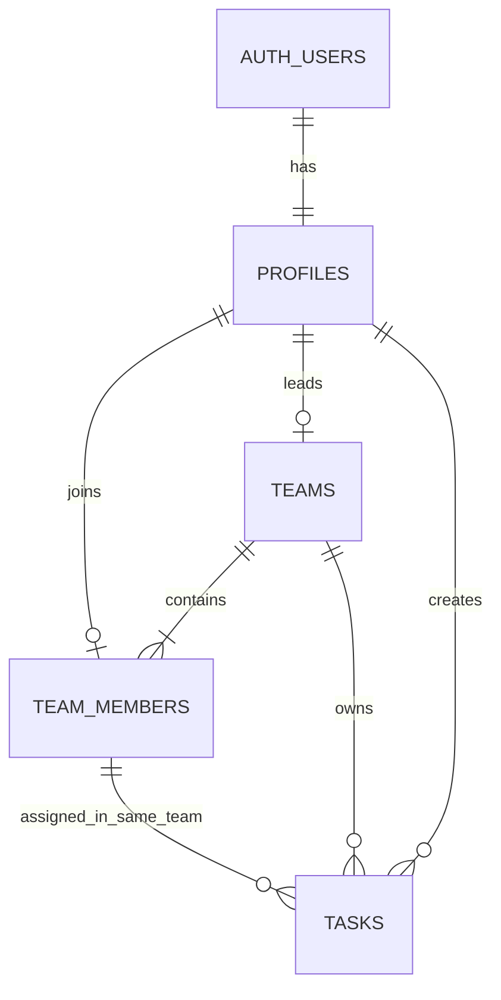

# Design: ระบบติดตามงานทีม

เอกสารออกแบบจาก `docs/plan.md` และ `docs/requirements.md` โดยใช้ `$sdlc-spec` ไม่เปลี่ยนขอบเขตหรือเกณฑ์ยอมรับของสองไฟล์ต้นทาง เอกสารนี้เป็นแบบสำหรับพัฒนาต่อ ยังไม่ได้สร้างตารางหรือฟีเจอร์จริง

## 1. ขอบเขตและแนวทางระบบ

- ทำ US-1 → US-2 → US-3 → US-4 ก่อน ส่วน US-5 และ US-6 เป็นงานเสริม ทำตามลำดับเมื่อมีเวลา
- ใช้ Next.js 16 App Router (ระบบจัดหน้าเว็บ) + TypeScript + Tailwind, Supabase Postgres (ฐานข้อมูล), Supabase Auth (ระบบบัญชีผู้ใช้) และ Vercel (บริการนำเว็บขึ้นใช้งาน)
- เปิด RLS หรือ Row Level Security (กติกาคัดกรองแต่ละแถวตามผู้ใช้) ทุกตารางของแอป การซ่อนปุ่มบนเว็บไม่ถือเป็นการป้องกันข้อมูล
- ใช้ `lib/supabase/server.ts` สำหรับอ่านและบันทึกข้อมูลฝั่งเซิร์ฟเวอร์ และ `lib/supabase/client.ts` เมื่อจำเป็นต้องทำงานในเบราว์เซอร์ ใช้ publishable key (กุญแจสาธารณะของโปรเจกต์) คู่กับบัญชีที่ล็อกอิน ไม่ใช้ Supabase secret/service-role key
- ตรวจตัวตนฝั่งเซิร์ฟเวอร์ด้วย `supabase.auth.getUser()` หรือ `getClaims()` ก่อนทำงานที่ต้องล็อกอิน ส่วนฐานข้อมูลใช้ `auth.uid()` (รหัสผู้ใช้ที่ยืนยันแล้ว) ไม่รับตัวตนผู้กระทำจากฟอร์ม
- `proxy.ts` ดูแลการต่ออายุ session (สถานะล็อกอิน) แต่ทุกหน้าที่ป้องกันและทุกคำสั่งบันทึกต้องตรวจสิทธิ์เองด้วย ปิด Cache Components ตาม `AGENTS.md` และไม่เก็บข้อมูลส่วนตัวในแคชที่ใช้ร่วมกัน
- คง `AGENTS.md` เดิม เพราะมีกติกาและคำสั่งโปรเจกต์อยู่แล้ว งานนี้สร้างเฉพาะ `docs/design.md`

### ขอบเขตที่คงตามต้นทาง

สมาชิกทุกคนเห็นรหัสเชิญและข้อมูลเพื่อนร่วมทีม หัวหน้ามอบงานให้ตัวเองได้ งานหนึ่งชิ้นมีผู้รับหนึ่งคน วันกำหนดส่งไม่มีเวลาและใช้วันตาม `Asia/Bangkok` ไม่มีการออกจากทีม ย้ายทีม เปลี่ยนหัวหน้า เตะสมาชิก หรือแก้ไข/ลบงานผ่านหน้าเว็บ

แม้ไม่มีหน้าจอแก้ไขรายละเอียดงาน หัวหน้ายังมีสิทธิ์แก้ข้อมูลเนื้อหางานภายในทีมตามแผนเดิม โดยฐานข้อมูลต้องคงเงื่อนไขผู้รับอยู่ทีมเดียวกันเสมอ การลบงานกรณีจำเป็นทำโดยผู้ดูแลผ่าน Supabase Table Editor ตามแผน ไม่ให้เว็บมีสิทธิ์ลบ

## 2. Data model (แบบข้อมูล)

ตารางของแอปอยู่ใน schema `public` (พื้นที่ตารางที่แอปเข้าถึง) บัญชีและรหัสผ่านให้ Supabase Auth ดูแลใน `auth.users` ไม่สร้างตารางรหัสผ่านเอง

PK หมายถึงคีย์หลักที่ระบุแถวไม่ซ้ำ, FK หมายถึงคีย์ที่อ้างถึงอีกตาราง, unique คือห้ามค่าซ้ำ และ default คือค่าเริ่มต้น ถ้าไม่เขียนว่า nullable ให้ถือว่าห้ามว่าง

| ตาราง | คอลัมน์ | ชนิดข้อมูล | คีย์ / ค่าเริ่มต้น / กติกา |
|---|---|---|---|
| `profiles` | `user_id` | `uuid` | PK, FK → `auth.users(id)`; หนึ่งแถวต่อบัญชี |
| `profiles` | `display_name` | `text` | ตัดช่องว่างหัวท้ายแล้วต้องไม่ว่าง |
| `profiles` | `email` | `text` | อ่านจาก `auth.users.email` เท่านั้น ไม่รับจากคำขอแก้โปรไฟล์ |
| `profiles` | `created_at` | `timestamptz` | default `now()`; วันเวลาสร้าง |
| `teams` | `id` | `uuid` | PK, default `gen_random_uuid()` |
| `teams` | `name` | `text` | ตัดช่องว่างหัวท้ายแล้วต้องไม่ว่าง |
| `teams` | `invite_code` | `text` | unique, ตัวอักษรพิมพ์ใหญ่ A–Z และตัวเลข 0–9 รวม 6 ตัว |
| `teams` | `created_by` | `uuid` | FK → `profiles(user_id)`, unique; เป็นหัวหน้าทีม |
| `teams` | `created_at` | `timestamptz` | default `now()` |
| `team_members` | `user_id` | `uuid` | PK, FK → `profiles(user_id)`; บังคับหนึ่งคนอยู่ได้หนึ่งทีม |
| `team_members` | `team_id` | `uuid` | FK → `teams(id)` |
| `team_members` | `joined_at` | `timestamptz` | default `now()` |
| `tasks` | `id` | `uuid` | PK, default `gen_random_uuid()` |
| `tasks` | `team_id` | `uuid` | FK → `teams(id)`; เปลี่ยนทีมของงานไม่ได้ |
| `tasks` | `title` | `text` | ตัดช่องว่างหัวท้ายแล้วต้องไม่ว่าง |
| `tasks` | `description` | `text` | nullable; รายละเอียดไม่บังคับ |
| `tasks` | `due_date` | `date` | nullable; วันกำหนดส่ง ไม่มีเวลา |
| `tasks` | `assignee_id` | `uuid` | FK → `profiles(user_id)`; ต้องเป็นสมาชิกทีมของงาน |
| `tasks` | `created_by` | `uuid` | FK → `profiles(user_id)`; ผู้สร้างต้องเป็นหัวหน้าทีม |
| `tasks` | `status` | `text` | default `todo`; รับเฉพาะ `todo`, `in_progress`, `done` |
| `tasks` | `created_at` | `timestamptz` | default `now()`; ผู้ใช้เปลี่ยนไม่ได้ |
| `tasks` | `updated_at` | `timestamptz` | default `now()`; ฐานข้อมูลปรับเมื่อแก้งาน |

### ความสัมพันธ์และข้อบังคับ

1. `auth.users` หนึ่งบัญชีมี `profiles` หนึ่งแถว สร้างโปรไฟล์ด้วย trigger (คำสั่งที่ฐานข้อมูลเรียกอัตโนมัติ) หลังสมัคร หากสร้างโปรไฟล์ไม่สำเร็จให้การสมัครล้มเหลวทั้งรายการ ไม่ทิ้งบัญชีที่ไม่มีชื่อ
2. ตอนสมัครรับชื่อจากข้อมูลประกอบการสมัคร ตรวจว่าไม่ว่างในฐานข้อมูลด้วย อีเมลคัดลอกจากบัญชี Auth และหาก Auth เปลี่ยนอีเมลที่ยืนยันแล้ว ให้ trigger ปรับ `profiles.email` ให้ตรงกัน ไม่ใช้ข้อมูลประกอบการสมัครเป็นหลักฐานของอีเมลหรือสิทธิ์
3. `teams` หนึ่งทีมมี `team_members` หลายคน รวมผู้สร้างทีม ไม่เก็บคอลัมน์บทบาทซ้ำ: ถ้า `team_members.user_id = teams.created_by` ให้แสดง “หัวหน้า” คนอื่นแสดง “สมาชิก”
4. เพิ่ม unique `(team_id, user_id)` ใน `team_members` เพื่อให้ `tasks(team_id, assignee_id)` อ้างถึงคู่นี้เป็น FK ได้ ผู้รับนอกทีมจึงบันทึกไม่ได้ แม้หลบหน้าเว็บหรือแก้คำขอเอง (AC-3.4)
5. เพิ่ม FK แบบตรวจตอนจบธุรกรรมจาก `teams(id, created_by)` → `team_members(team_id, user_id)` โดยใช้ `DEFERRABLE INITIALLY DEFERRED` เพื่อรับรองว่าหัวหน้ามีสมาชิกภาพในทีมตัวเอง ฟังก์ชันสร้างทีมจึงเพิ่มทีมก่อน แล้วเพิ่มสมาชิกผู้สร้างให้ครบก่อนจบรายการได้
6. ใช้ `CHECK` (เงื่อนไขประจำตาราง) ตรวจชื่อทีม ชื่องาน และชื่อที่แสดงหลังตัดช่องว่าง รวมถึงรูปแบบรหัสเชิญและค่าของสถานะ ไม่มีข้อบังคับให้วันกำหนดส่งต้องอยู่ในอนาคต เพราะต้องสร้างงานเมื่อวานเพื่อทดสอบ AC-4.5 ได้
7. ไม่ให้แอปแก้ `teams.created_by` หรือย้าย/ลบสมาชิก กำหนด FK ที่เกี่ยวกับทีม สมาชิก และงานให้ปฏิเสธการลบเมื่อมีข้อมูลอ้างอิง ไม่ใช้การลบต่อเนื่องที่ทำให้งานหายโดยไม่ตั้งใจ การลบบัญชีไม่ใช่ขอบเขตเว็บนี้
8. เพิ่มดัชนี (ตัวช่วยค้นหา) ที่ `team_members(team_id)`, `tasks(team_id, status)` และ `tasks(assignee_id, due_date)` ส่วน PK และ unique มีดัชนีของตนอยู่แล้ว

## 3. ตารางสิทธิ์: แบบสำหรับ RLS

`select` = อ่าน, `insert` = เพิ่ม, `update` = แก้, `delete` = ลบ ตารางนี้หมายถึงการเรียกตารางโดยตรงด้วย publishable key และตัวตนผู้ใช้ เครื่องหมาย “–” หมายถึงปฏิเสธ ไม่มีสิทธิ์โดยปริยาย

| ตาราง | บทบาทเมื่อเทียบกับแถวข้อมูล | select | insert | update | delete | เงื่อนไข / ช่องทางอื่น |
|---|---|---|---|---|---|---|
| `profiles` | `anon` (ยังไม่ล็อกอิน) | – | – | – | – | สมัครผ่าน Auth เท่านั้น |
| `profiles` | เจ้าของโปรไฟล์ ทั้งก่อนและหลังมีทีม | ✓ | – | – | – | `user_id = auth.uid()` |
| `profiles` | หัวหน้าหรือสมาชิกทีมเดียวกับเจ้าของ | ✓ | – | – | – | อ่านชื่อและอีเมลเพื่อนร่วมทีมได้ |
| `profiles` | ผู้ใช้คนอื่นที่ไม่มีทีมร่วมกัน | – | – | – | – | แม้รู้ `user_id` ก็อ่านไม่ได้ |
| `teams` | `anon` | – | – | – | – | ไม่เปิดรหัสเชิญให้ผู้ไม่ล็อกอิน |
| `teams` | ผู้ล็อกอินที่ยังไม่มีทีม | – | – | – | – | สร้าง/เข้าทีมผ่านฟังก์ชันเท่านั้น |
| `teams` | หัวหน้าทีมนั้น | ✓ | – | – | – | อ่านทีมตนเอง; สร้างผ่านฟังก์ชัน |
| `teams` | สมาชิกทีมนั้น | ✓ | – | – | – | เห็นรหัสเชิญตามแผน |
| `teams` | คนนอกทีมนั้น | – | – | – | – | ใช้รหัสเชิญผ่านฟังก์ชัน ไม่อ่านตารางค้นหาเอง |
| `team_members` | `anon` หรือผู้ล็อกอินที่ยังไม่มีทีม | – | – | – | – | ผู้ไม่มีทีมสอบถามสถานะได้จากฟังก์ชัน |
| `team_members` | หัวหน้าทีมนั้น | ✓ | – | – | – | อ่านสมาชิกทั้งหมดในทีม |
| `team_members` | สมาชิกทีมนั้น | ✓ | – | – | – | อ่านสมาชิกทั้งหมดในทีม |
| `team_members` | คนนอกทีมนั้น | – | – | – | – | ห้ามเพิ่มตนเองเข้าทีมด้วยการ insert ตรง |
| `tasks` | `anon` หรือผู้ล็อกอินที่ยังไม่มีทีม | – | – | – | – | ไม่มีสิทธิ์ดูงาน |
| `tasks` | หัวหน้าทีมของงาน | ✓ | – | ✓ | – | เพิ่มผ่าน `create_task`; แก้เนื้อหา ผู้รับ และสถานะได้ภายในทีม |
| `tasks` | สมาชิกผู้รับงานที่ไม่ใช่หัวหน้า | ✓ | – | เฉพาะสถานะ | – | RLS ตรวจแถว และ trigger จำกัดคอลัมน์ |
| `tasks` | สมาชิกทีมเดียวกันที่ไม่ได้รับงาน | ✓ | – | – | – | ดูงานของทีมได้ แต่แก้ไม่ได้ |
| `tasks` | คนนอกทีมของงาน | – | – | – | – | ห้ามอ่านหรือแก้ข้ามทีม |

การสร้างโปรไฟล์ทำโดย trigger ของ Auth เท่านั้น ส่วนการเพิ่มทีม สมาชิก และงานทำผ่านฟังก์ชันที่ตรวจสิทธิ์ จึงไม่ต้องมีสิทธิ์ insert โดยตรงของผู้ใช้ ทุกตารางยังต้องเปิด RLS แม้ไม่มีช่องทางเพิ่มข้อมูลโดยตรง

### วิธีเขียน policy (เงื่อนไขอนุญาตแต่ละตาราง)

- ใช้ฟังก์ชันช่วยอ่านทีมปัจจุบันของ `auth.uid()` เพื่อคัดแถว `teams`, `team_members`, `tasks` ไม่ให้ policy ของสมาชิกย้อนอ่านตารางตัวเองจนวนซ้ำ
- `profiles` อ่านได้เมื่อเป็นเจ้าของ หรือผู้ใช้กับเจ้าของโปรไฟล์มีสมาชิกภาพในทีมเดียวกัน การไม่มีทีมไม่ทำให้เห็นโปรไฟล์ของคนอื่นที่ไม่มีทีมเหมือนกัน
- `tasks` อ่านได้เมื่อ `team_id` เป็นทีมปัจจุบัน ส่วนแก้ไขต้องผ่านทั้ง `USING` (สิทธิ์บนแถวก่อนแก้) และ `WITH CHECK` (สิทธิ์บนแถวหลังแก้): เป็นหัวหน้าทีมนั้น หรือเป็นผู้รับงานของแถวนั้น และยังอยู่ทีมเดียวกัน
- RLS ไม่ได้จำกัดรายคอลัมน์ จึงต้องใช้ trigger เปรียบเทียบค่าก่อน/หลังร่วมด้วยสำหรับ AC-4.4
- ถอนสิทธิ์เขียนโดยตรงที่ไม่ใช้ และไม่สร้าง policy แบบอนุญาตทุกแถวให้ `anon` หรือผู้ใช้ทั่วไป ผู้ดูแลที่ทำงานใน Table Editor เป็นงานดูแลแยกจากสิทธิ์ของเว็บ

## 4. Function (คำสั่งในฐานข้อมูล)

RPC คือการเรียกฟังก์ชันฐานข้อมูลจากแอป ส่วน `SECURITY DEFINER` คือให้ฟังก์ชันทำงานด้วยสิทธิ์เจ้าของเพื่อทำรายการที่ผู้ใช้ไม่มีสิทธิ์เรียกตารางโดยตรง ต้องจำกัดสิทธิ์และตรวจผู้กระทำภายในทุกครั้ง

ฟังก์ชันทุกตัวที่เพิ่มสิทธิ์ต้องกำหนด `search_path` ให้ปลอดภัย เช่นค่าว่าง แล้วอ้างชื่อ schema ให้ครบ ไม่ประกอบ SQL จากข้อความผู้ใช้ ถอน `EXECUTE` จาก `PUBLIC` และ `anon` และให้เฉพาะ `authenticated` (ผู้ล็อกอิน) เท่าที่จำเป็น ฟังก์ชัน trigger ให้ระบบเรียกเท่านั้น ฟังก์ชันช่วยที่เปิดใน `public` ได้แก่ `current_team_id`, `is_team_lead` และ `is_current_team_member` คืนเพียงทีมของผู้เรียกหรือผลจริง/เท็จที่ผูกกับผู้เรียก ไม่ให้ค้นหารายชื่อหรือข้อมูลคนนอกทีม

| ฟังก์ชันที่วางแผน | ข้อมูลที่รับ | หน้าที่ / ผลที่คืน | อ้างอิง |
|---|---|---|---|
| trigger สร้าง/ซิงก์โปรไฟล์ | แถวจาก `auth.users` | สร้างชื่อและอีเมลจากการสมัคร; ซิงก์อีเมลที่ Auth เปลี่ยน; ไม่เปิดเรียกจากเว็บ | US-1, AC-1.1, AC-6.4 |
| `current_team_id()` | ไม่มี | คืนรหัสทีมของผู้เรียก หรือ `null`; ไม่รับ `user_id` ให้สืบค้นคนอื่น | AC-2.4, AC-2.6, AC-3.7 |
| `is_current_team_member(target_user_id)` | รหัสเจ้าของโปรไฟล์ | คืนจริงเมื่อเป้าหมายอยู่ทีมปัจจุบันของผู้เรียก; ไม่มีทีมให้คืนเท็จ; ไม่คืนชื่อหรืออีเมล | AC-2.6 |
| `create_team(team_name)` | ชื่อทีม | ตรวจล็อกอิน/ไม่มีทีม สุ่มรหัสเชิญ สร้างทีมและสมาชิกหัวหน้าในรายการเดียว คืนทีมที่ผู้เรียกมีสิทธิ์แล้ว | AC-2.2, AC-2.4, AC-2.5 |
| `join_team(invite_code)` | รหัสเชิญ | ตรวจล็อกอิน/ไม่มีทีมและรหัส เพิ่มผู้เรียกเป็นสมาชิก คืนข้อมูลทีมหลังเข้าร่วมสำเร็จ | AC-2.3, AC-2.4, AC-2.6 |
| `create_task(title, description, due_date, assignee_id)` | เนื้อหางานและผู้รับ | หาทีมและหัวหน้าจากตัวตนที่ยืนยันแล้ว ตรวจผู้รับ สร้างงานสถานะ `todo` คืนงานที่บันทึกแล้ว | AC-3.1, AC-3.3–AC-3.5, AC-6.2 |

### สร้างและเข้าร่วมทีมอย่างครบถ้วน

- ทั้ง `create_team` และ `join_team` ทำงานเป็น transaction (รายการที่สำเร็จทั้งหมดหรือยกเลิกทั้งหมด) ล็อกแถวโปรไฟล์ของผู้เรียกก่อนตรวจสมาชิกภาพ ใช้ลำดับล็อกเดียวกันทั้งสองฟังก์ชันเพื่อกันคำขอพร้อมกันของบัญชีเดียว
- ตรวจว่ามีทีมแล้วก่อนค้นหารหัส ถ้ามีให้ตอบ “คุณมีทีมอยู่แล้ว” เสมอ รวมถึงคำขอที่ส่งเองนอกหน้าจอ ใช้ PK ของ `team_members.user_id` เป็นด่านสุดท้ายและแปลงข้อผิดพลาดกรณีชนกันเป็นข้อความเดียวกัน (AC-2.4)
- `create_team` ตัดช่องว่างชื่อ ถ้าว่างตอบ “กรุณากรอกชื่อทีม” สุ่มรหัส 6 ตัวด้วยแหล่งสุ่มที่เหมาะกับรหัสเชิญในฐานข้อมูลและ unique constraint หากรหัสซ้ำให้สุ่มใหม่แบบมีจำนวนครั้งจำกัด หากยังสร้างไม่ได้ให้ยกเลิกทั้งรายการ ไม่เหลือทีมกำพร้า
- `join_team` ตัดช่องว่างและแปลงรหัสเป็นตัวพิมพ์ใหญ่ก่อนเทียบ รหัสผิดรูปแบบหรือหาไม่พบตอบเหมือนกันว่า “ไม่พบทีมจากรหัสนี้” ไม่คืนรายชื่อทีม รหัสอื่น หรือสมาชิกก่อนเข้าทีมสำเร็จ
- ไม่มีฟังก์ชันค้นหาทีมสาธารณะด้วยรหัสเชิญ เมื่อเข้าทีมสำเร็จแล้วจึงอ่านข้อมูลผ่าน RLS ปกติ การรู้รหัสที่ถูกต้องถือเป็นการได้รับเชิญตาม US-2

### สร้างงานและเปลี่ยนสถานะ

- `create_task` ไม่รับ `team_id`, `created_by` หรือสถานะเริ่มต้นจากฟอร์ม ใช้ผู้เรียกและทีมในฐานข้อมูล ตรวจว่าผู้เรียกเป็นหัวหน้า ตัดช่องว่างชื่องาน และตรวจผู้รับเป็นสมาชิกก่อนเพิ่มข้อมูล FK ยังตรวจซ้ำเพื่อกันข้อมูลผิด
- ใช้ trigger บน `tasks` ตรวจว่าการเพิ่มงานมาจากหัวหน้าของทีม, `created_by` ตรงผู้เรียก และสถานะเริ่มต้นเป็น `todo` แม้ฟังก์ชันมีสิทธิ์สูงก็ต้องผ่านกติกานี้
- การเปลี่ยนสถานะใช้คำสั่ง update ปกติที่อยู่ใต้ RLS ไม่ใช้ฟังก์ชันเพิ่มสิทธิ์ ฟอร์มส่งเพียงรหัสงานกับสถานะ และตรวจค่ากับรายการที่ยอมรับทั้งฝั่งเซิร์ฟเวอร์และฐานข้อมูล
- trigger ก่อน update ตรวจผู้กระทำจาก `auth.uid()` และข้อมูลเก่า: สมาชิกผู้รับงานแก้ได้เพียง `status`; คอลัมน์อื่นทั้งหมดต้องเท่าเดิม รวม `team_id`, `created_by`, `id` และเวลา ส่วน `updated_at` ให้ trigger กำหนดเองหลังตรวจ ห้ามยอมให้เปลี่ยนคอลัมน์อื่นโดยส่งพร้อมสถานะ
- หัวหน้าแก้ `title`, `description`, `due_date`, `assignee_id`, `status` ได้ แต่ห้ามเปลี่ยน `id`, `team_id`, `created_by`, `created_at`; ผู้รับใหม่ต้องยังอยู่ทีมเดิม สมาชิกคนอื่นและคนนอกทีมไม่มีสิทธิ์แก้
- สถานะทั้งสามเลือกสลับกลับไปมาได้ตาม AC-4.1 ไม่มีข้อบังคับว่าต้องเดินหน้าเท่านั้น เมื่อฐานข้อมูลยืนยันสำเร็จให้โหลดข้อมูลหน้าใหม่เพื่อย้ายคอลัมน์ทันที หากไม่สำเร็จคงค่าเดิมและแจ้งข้อผิดพลาด

## 5. หน้าจอและการไหลของผู้ใช้

| route (ที่อยู่หน้า) | ผู้ใช้และสิ่งที่แสดง | user story / เกณฑ์สำคัญ |
|---|---|---|
| `/` | คงหน้าตรวจการเชื่อมต่อเดิมได้ เพิ่มทางไป `/login`, `/team`, `/tasks` ตามสถานะ; ไม่แสดงค่าลับหรือข้อมูลทีมอื่น | จุดเริ่มต้น |
| `/login` | สมัครด้วยชื่อ อีเมล รหัสผ่านอย่างน้อย 6 ตัวอักษร หรือล็อกอินด้วยอีเมล/รหัสผ่าน | US-1, AC-1.1–AC-1.2 |
| `/team` | ถ้ายังไม่มีทีม แสดงฟอร์มสร้างทีมและเข้าทีม; ถ้ามีทีม แสดงชื่อ รหัสเชิญ และสมาชิกพร้อมบทบาท | US-2, AC-2.1–AC-2.6 |
| `/tasks` | งานของทีมแบ่ง 3 คอลัมน์ ฟอร์มสร้างงานเฉพาะหัวหน้า และตัวเลือกสถานะตามสิทธิ์ | US-3, US-4 |
| `/my` | งานที่ผู้เรียกเป็นผู้รับ เรียงกำหนดส่ง ซ่อนงานเสร็จเริ่มต้น และเปลี่ยนสถานะได้ | US-5; ตรวจการล็อกอินตาม AC-1.5 |

### บัญชีและการนำทาง: US-1

- ใน workshop ต้องปิด Confirm email ใน Supabase → Authentication → Sign In / Providers → Email ตามแผนก่อนทดสอบ AC-1.1 เพื่อให้สมัครแล้วล็อกอินได้ทันที หากยังเปิดอยู่ให้แจ้งว่าต้องตั้งค่าก่อน ไม่แสดงว่าล็อกอินสำเร็จทั้งที่ยังไม่มี session
- สมัครสำเร็จและมีโปรไฟล์แล้วไป `/team` ล็อกอินสำเร็จไป `/team` เช่นกัน ส่วนรหัสผ่านผิดใช้ข้อความ “อีเมลหรือรหัสผ่านไม่ถูกต้อง” ตาม AC-1.2
- แถบบนของหน้าที่ล็อกอินแสดงชื่อจากโปรไฟล์ตนเองและปุ่มออกจากระบบ เมื่อออกให้ยกเลิก session กลับ `/login` และรีเฟรชหน้าป้องกันไม่ให้ข้อมูลเดิมค้าง
- ใช้ session แบบ cookie ที่คงอยู่หลังปิดเบราว์เซอร์และมีการต่ออายุ ไม่ใช้ตัวแปรในหน่วยความจำหรือ cookie ที่หมดอายุเมื่อปิดเบราว์เซอร์เพียงอย่างเดียว ทดสอบปิด/เปิดใหม่ภายในวันเดียวกันด้วยเบราว์เซอร์ปกติ (AC-1.4)
- ผู้ไม่ล็อกอินเปิด `/team`, `/tasks`, `/my` ให้พาไป `/login`; ผู้ล็อกอินที่ยังไม่มีทีมเปิด `/tasks` หรือ `/my` ให้พาไป `/team` ก่อนอ่านงาน แม้ยังไม่ทำ US-5 ก็ต้องมีการป้องกัน `/my` ตาม AC-1.5

### ทีมและกระดานงาน: US-2 ถึง US-4

- `/team` อ่านทีมปัจจุบันจากฐานข้อมูล ถ้ามีทีมแล้วไม่แสดงสองฟอร์มสร้าง/เข้าทีม รายชื่ออ่านจากสมาชิกและโปรไฟล์ที่ RLS อนุญาต ไม่อ่านผู้ใช้ทั้งหมดมาให้เบราว์เซอร์กรอง
- `/tasks` อ่านเฉพาะทีมปัจจุบัน แสดงคอลัมน์ `todo` = “ยังไม่เริ่ม”, `in_progress` = “กำลังทำ”, `done` = “เสร็จแล้ว” ทุกคนในทีมเห็นงานทั้งหมด
- แต่ละบัตรงานแสดงชื่องาน ชื่อผู้รับ และกำหนดส่ง ถ้าไม่มีวันที่ให้แสดง “ไม่มีกำหนด” รายละเอียดงานอ่านได้ในส่วนขยายของบัตร ไม่เพิ่มหน้าจอแก้ไขหรือลบงาน
- ฟอร์มสร้างมีชื่องาน รายละเอียด วันกำหนดส่ง และผู้รับ เลือกผู้รับจากสมาชิกทีมรวมตัวหัวหน้าเท่านั้น ไม่ให้พิมพ์รหัสผู้รับอิสระ
- ชื่อทีมว่างตอบ “กรุณากรอกชื่อทีม”; ชื่องานว่างตอบ “กรุณากรอกชื่องาน” และไม่เรียกบันทึก ขณะเดียวกันฐานข้อมูลต้องปฏิเสธคำขอที่ข้ามการตรวจหน้าเว็บด้วย
- ถ้าทีมไม่มีงานแสดง “ยังไม่มีงานในทีม” ส่วนคอลัมน์ว่างในทีมที่มีงานแล้วใช้ข้อความสั้น เช่น “ไม่มีงานในสถานะนี้”
- แสดงตัวเลือกเปลี่ยนสถานะเฉพาะผู้รับงานหรือหัวหน้า เมื่อไม่มีสิทธิ์หรือแถวถูกลบจน update ไม่ได้ ให้แจ้งว่า “ไม่สามารถเปลี่ยนสถานะงานนี้ได้” ไม่ถือว่าคำสั่งที่แก้ได้ศูนย์แถวคือสำเร็จ

### วันกำหนดส่งและงานของฉัน

- เก็บกำหนดส่งเป็น `date` และคำนวณวันปัจจุบันตาม `Asia/Bangkok` ทั้งฝั่งเซิร์ฟเวอร์และเบราว์เซอร์ ไม่ใช้วันตามเขตเวลาของเครื่องให้บริการหรือเครื่องผู้ใช้โดยปริยาย
- สูตรป้ายแดง “เลยกำหนด”: มี `due_date` และ `due_date < วันนี้ในไทย` และ `status != 'done'` งานครบกำหนดวันนี้ยังไม่เลยกำหนด งานไม่มีวันที่และงานเสร็จไม่มีป้าย (AC-4.5)
- แสดงวันที่แบบไทยด้วย locale `th-TH` เช่น “14 พ.ย. 2569” ต้องจัดการวันแบบไม่มีเวลาโดยไม่แปลงแล้วทำให้เลื่อนวัน เปลี่ยนวันไทยเมื่อเปิดหน้าค้างไว้ต้องคำนวณป้ายใหม่
- `/my` เพิ่มเงื่อนไข `assignee_id = auth.uid()` ในคำสั่งอ่านภายใต้ RLS เดิม เรียง `due_date` จากน้อยไปมากและค่าว่างท้ายสุด ใช้ `created_at`, `id` เป็นตัวเรียงรองเมื่อวันเท่ากัน (AC-5.1)
- เริ่มต้นกรอง `status != 'done'` และมีช่อง “แสดงงานที่เสร็จแล้ว” (AC-5.2) ถ้าไม่มีงานที่ได้รับมอบหมายเลยแสดง “ยังไม่มีงานที่ได้รับมอบหมาย” พร้อมลิงก์ `/tasks` (AC-5.3); ถ้ามีแต่งานเสร็จที่ซ่อนอยู่ให้บอกว่าไม่มีงานค้างและชวนเปิดตัวเลือกนั้น
- เปลี่ยนสถานะใน `/my` ผ่านคำสั่งและกติกาชุดเดียวกับ `/tasks` (AC-5.4) การที่เพื่อนร่วมทีมอ่านงานกันได้ยังคงเดิม `/my` เป็นเพียงมุมมองที่กรองเพิ่ม

### สถานะหน้าจอและมือถือ: NFR-3, NFR-4

ทุกหน้ามีข้อความกำลังโหลด พื้นที่ไม่มีข้อมูล และข้อความผิดพลาดภาษาไทย พร้อมลองใหม่ตามเหมาะสม ฟอร์มคงค่าที่กรอกเมื่อบันทึกล้มเหลว ปิดปุ่มระหว่างส่งเพื่อกันกดซ้ำ และไม่แสดงข้อความข้อผิดพลาดดิบที่เผยโครงสร้างฐานข้อมูลหรือค่าลับ

ที่ความกว้าง 375px ขึ้นไปต้องไม่เลื่อนซ้ายขวา กระดานงานวางสามคอลัมน์เรียงลงบนจอแคบและวางข้างกันเมื่อพื้นที่พอ ใช้ป้ายชื่อช่องกรอก ปุ่มที่อ่านออก และข้อความ “เลยกำหนด” ร่วมกับสีแดงเพื่อไม่อาศัยสีอย่างเดียว

## 6. อีเมลแจ้งมอบหมาย: US-6 (งานเสริม)

ใช้ Gmail SMTP (บริการส่งอีเมล) กับ App Password (รหัสเฉพาะแอป) ของบัญชีทดลองตามข้อกำหนด ไม่ใช้บัญชีส่วนตัวหรือที่ทำงาน เก็บ `GMAIL_USER` และ `GMAIL_APP_PASSWORD` ใน `.env.local` และ Environment Variables ของ Vercel ฝั่งเซิร์ฟเวอร์เท่านั้น ห้ามขึ้นต้นด้วย `NEXT_PUBLIC_` และไม่ใส่ค่าจริงในไฟล์ตัวอย่าง โค้ด log หรือ git

ลำดับงานใน Server Action (คำสั่งที่หน้าเว็บเรียกให้เซิร์ฟเวอร์ทำ):

1. ตรวจผู้เรียกด้วย Auth แล้วเรียก `create_task` ภายใต้บัญชีของผู้เรียก หากสร้างล้มเหลวให้จบโดยไม่ส่งอีเมล (AC-6.2)
2. หลังฐานข้อมูลบันทึกสำเร็จ อ่านงานจาก `id` ที่ฐานข้อมูลคืนจริง พร้อมอีเมลผู้รับจาก `profiles`, ชื่อทีมจาก `teams` และชื่อผู้สร้างจาก `profiles` ภายใต้ RLS ไม่ใช้ผู้รับ ชื่องาน หรือชื่อทีมที่ส่งมาในคำขอเป็นแหล่งข้อมูลส่งเมล (AC-6.4)
3. ส่งหัวเรื่อง “งานใหม่: <ชื่องาน>” เนื้อหามีชื่องาน กำหนดส่งแบบไทยหรือ “ไม่มีกำหนด” ชื่อทีม และชื่อผู้มอบหมาย ใช้เนื้อหาแบบข้อความธรรมดาหรือหลีกอักขระให้ปลอดภัยหากใช้ HTML (AC-6.1)
4. รอผลการส่งในคำสั่งเซิร์ฟเวอร์เดียวกัน ไม่ปล่อยงานส่งเมลลอยหลังตอบกลับ ตั้งเวลารอ SMTP และเวลาทำงานของคำสั่งให้จบภายในกรอบ 1 นาที ไม่เปิดคำสั่งส่งอีเมลอิสระที่ผู้ใช้ทั่วไปเรียกซ้ำกับงานเดิมได้
5. หาก SMTP หรือการอ่านข้อมูลสำหรับอีเมลล้มเหลว ห้ามย้อนลบงานที่สร้างสำเร็จ ให้แสดง “สร้างงานแล้ว แต่ส่งอีเมลแจ้งไม่สำเร็จ” และโหลดกระดานที่มีงานใหม่ ไม่ส่งคำสั่งสร้างงานซ้ำอัตโนมัติ (AC-6.3)

แบบเริ่มต้นส่งครั้งเดียวหลังสร้างผ่านเว็บ ไม่มีระบบส่งซ้ำอัตโนมัติหรืออีเมลเมื่อเปลี่ยนสถานะ การรับอีเมลจริงภายใน 1 นาทีเป็นสิ่งที่ต้องทดสอบกับบัญชีจริงตาม AC-6.1 เพราะผลตอบรับ SMTP เพียงอย่างเดียวยังไม่พิสูจน์ว่าเมลถึงกล่องผู้รับแล้ว หากไม่ผ่านให้รายงาน AC นี้ว่ายังไม่ผ่าน

## 7. แผนพัฒนาและตรวจรับ

การเปลี่ยนฐานข้อมูลจริงให้เขียนไฟล์ SQL ใน `supabase/migrations/` เท่านั้น แล้วให้ผู้ใช้รันผ่าน Supabase SQL Editor ตาม `AGENTS.md` เอกสารนี้ไม่สั่งรัน SQL และไม่สร้างข้อมูลทดสอบแทนผู้ใช้

| ลำดับ | งานที่จะทำ | สิ่งที่ต้องตรวจ |
|---|---|---|
| 1 | US-1: โปรไฟล์จาก Auth, RLS โปรไฟล์เจ้าของ, `/login`, แถบผู้ใช้ และการป้องกันหน้า | AC-1.1–AC-1.5; ทดสอบสมัคร ชื่อถูกต้อง รหัสผ่านผิด ออกจากระบบ และปิด/เปิดเบราว์เซอร์ |
| 2 | US-2: ทีม สมาชิก ฟังก์ชันสร้าง/เข้าทีม และขยาย RLS โปรไฟล์เพื่อนร่วมทีม | AC-2.1–AC-2.6; รวมชื่อว่าง รหัสผิด สร้าง/เข้าซ้ำ และคำขอพร้อมกัน |
| 3 | US-3: ตารางงาน ข้อบังคับผู้รับ ฟังก์ชันสร้างงาน และกระดาน | AC-3.1–AC-3.7; รวมชื่องานว่าง สมาชิกปลอมคำขอสร้าง มอบให้คนนอก และอ่านข้ามทีม |
| 4 | US-4: RLS แก้สถานะ trigger จำกัดคอลัมน์ และป้ายเลยกำหนด | AC-4.1–AC-4.5; ทดสอบหัวหน้า ผู้รับ คนอื่น และปลอมคำขอแก้หลายคอลัมน์ |
| 5 | US-5 (เสริม): หน้างานของฉัน | AC-5.1–AC-5.4; รวมวันเท่ากัน ไม่มีวัน งานเสร็จ และไม่มีงาน |
| 6 | US-6 (เสริม): SMTP ฝั่งเซิร์ฟเวอร์หลังบันทึกงาน | AC-6.1–AC-6.5; รับเมลภายใน 1 นาที บังคับส่งล้มเหลว งานต้องคงอยู่ และปลอมอีเมลผู้รับไม่ได้ |
| ทุกขั้น | ความปลอดภัยและการใช้งาน | NFR-1–NFR-4; เปิด RLS, ไม่มีค่าลับใน git/ไฟล์เบราว์เซอร์, สถานะหน้าไทย และจอ 375px |

### ชุดทดสอบสิทธิ์ที่ต้องทำจริง

ใช้บัญชี A เป็นหัวหน้าทีม 1, B เป็นสมาชิกทีม 1, C เป็นหัวหน้าทีม 2 ตาม requirements ทดสอบกรณีไม่มีทีมก่อนเข้าทีม และทดสอบ `anon` โดยไม่มี session ไม่ต้องเตรียมแถวตัวอย่างล่วงหน้า

- ใช้ publishable key กับ session ของแต่ละบัญชีเรียกตารางโดยตรงด้วย เพื่อพิสูจน์ฐานข้อมูลป้องกันได้แม้ข้ามหน้าเว็บ: C อ่านทีม 1 สมาชิกทีม 1 และโปรไฟล์ A/B ไม่ได้; A/B อ่านทีม 2 และโปรไฟล์ C ไม่ได้; `anon` อ่านทั้งสี่ตารางไม่ได้ (AC-2.6, AC-3.7, NFR-1)
- ก่อน B เข้าทีม B ต้องอ่านโปรไฟล์ตนเองได้ แต่ไม่เห็นโปรไฟล์ A หรือทีม 1; หลังเข้าทีมจึงเห็นข้อมูลเพื่อนร่วมทีม การปฏิเสธ select อาจคืนรายการว่าง ให้ตรวจว่าไม่มีข้อมูลรั่ว ไม่บังคับว่าต้องเป็น error เสมอ
- ส่งคำขอสร้าง/เข้าทีมพร้อมกันสองรายการด้วยบัญชีเดียว ต้องสำเร็จได้เพียงรายการเดียว ไม่มีทีมที่ขาดสมาชิกหัวหน้า และอีกคำขอได้ “คุณมีทีมอยู่แล้ว” (AC-2.4)
- B สร้างงานผ่านฟังก์ชันหรือ insert ตรงไม่ได้; A มอบให้ C ไม่ได้; การ insert ตรงของ A ก็ต้องถูกปฏิเสธเพราะใช้ `create_task` เป็นช่องทางเพิ่มงาน (AC-3.3, AC-3.4)
- A สร้างงานให้ B และอีกงานให้ A; B เปลี่ยนสถานะงานของ B ได้ แต่เปลี่ยนของ A ไม่ได้ ลองแก้ชื่องาน รายละเอียด กำหนดส่ง ผู้รับ ทีม ผู้สร้าง และเวลาของงาน B ทั้งแบบแก้เดี่ยวและส่งพร้อมสถานะ ต้องปฏิเสธทั้งคำขอ ไม่แก้เฉพาะบางส่วน (AC-4.1–AC-4.4)
- A เปลี่ยนสถานะงานของ B ได้; C เปลี่ยนงานทีม 1 ไม่ได้; ค่าสถานะนอกเหนือสามค่าต้องถูกปฏิเสธ ทดสอบว่าหัวหน้าเปลี่ยนผู้รับไป C ไม่ได้เช่นกัน
- A สร้างงานกำหนดเมื่อวาน วันนี้ วันพรุ่งนี้ และไม่มีวัน ตรวจป้ายทั้งงานค้างและงานเสร็จ รวมช่วงเปลี่ยนวันไทย (AC-4.5)
- US-6 ใช้ผู้รับจากฐานข้อมูลแม้คำขอแนบอีเมลอื่นมา; ทดลองให้ SMTP ล้มเหลวแล้วตรวจว่างานมีหนึ่งชิ้นและข้อความตรง AC-6.3 ไม่บันทึกรหัสผ่านหรือ session ลงรายงาน

ในขั้นพัฒนาให้ใช้ `npm run lint` ตรวจโค้ด, `npm test` ทดสอบ US-1 กับบริการ Auth จำลองและ PostgreSQL ในหน่วยความจำ และ `npm run build` ตรวจการประกอบเว็บตามคำสั่งใน `package.json` ขั้นตอนติดตั้ง SQL และตรวจรับบัญชีจริงอยู่ใน `docs/testing-us1.md` ผลทดสอบจำลองไม่ใช่การยืนยันว่าฐานข้อมูลจริงติดตั้งแล้ว

## 8. สมมติฐานการออกแบบและข้อจำกัด

- ต้นทางกำหนดสิทธิ์และขอบเขตเพียงพอสำหรับออกแบบ ไม่มีคำถามที่ต้องรอคำตอบก่อนเขียนเอกสารนี้
- ชื่อทีมซ้ำกันได้ เพราะแยกทีมด้วย `id` และรหัสเชิญที่ไม่ซ้ำ ไม่มีข้อกำหนดให้ชื่อทีมไม่ซ้ำ
- การตัดช่องว่าง/แปลงรหัสเชิญเป็นพิมพ์ใหญ่ การเรียงรองด้วยวันสร้าง และการไม่ให้แก้โปรไฟล์ผ่านหน้าเว็บเป็นรายละเอียดที่ปรับได้ โดยต้องไม่ลดสิทธิ์หรือเปลี่ยน AC เดิม
- รหัสเชิญ 6 ตัวเป็นข้อกำหนด MVP ควรเพิ่มการจำกัดความถี่การลองรหัสก่อนใช้จริง ส่วนยืนยันอีเมลให้เปิดกลับและตั้ง SMTP สำหรับ Auth เมื่อพ้น workshop ตามแผนเดิม SMTP แจ้งงานใน US-6 เป็นคนละหน้าที่กับอีเมลยืนยันบัญชี
- โค้ด US-1 ถึง US-4 เตรียมแล้ว วิธีติดตั้งและตรวจรับอยู่ใน `docs/testing-us1.md` และ `docs/testing-us2-us4.md` ต้องรัน SQL และทดสอบบัญชีจริงก่อนเริ่มงานเสริม US-5/US-6
